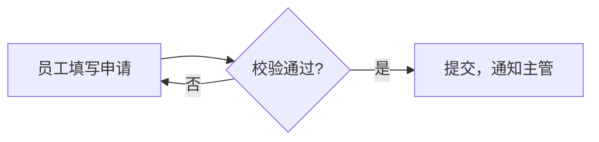

# PRD 与原型 `v4`

产品 Agent 用。前提：`pm-clarify` 已经把需求问清楚（`requirements.md`）。**PRD 要图文并茂：主流程有图、每屏有编号说明、关键状态能切换，你在评审页上直接给结论和回复。**

示例（照着写）：`tools/samples/prd-demo/`——`prd.md`、两屏原型、生成的 `review.html`，截图在 `shots/`。

## 文件布局
```
plans/prd/<需求 slug>/
  requirements.md               # 澄清结果（pm-clarify 产出）
  prd.md                        # PRD 正文
  prototype/01-<屏名>.html       # 原型，每屏一个文件，<title> 写屏名
  review.html                   # 评审页（PRD + 图 + 原型 + 评论），由工具生成
  comments-01.md                # 第 1 轮评审意见（你导出后粘贴的原文）
```

## 步骤

### 1. 画原型
- 先列出要画的屏（主流程优先，3–6 屏为宜），每屏一个独立 HTML 文件
- 原型是**可点击的页面**：真实的文案和字段；需要的交互用简单的 JS（切换、展开）
- **按视觉规范画**（见下面「视觉规范」）：把 `tools/ui-tokens.css` 整段复制进每屏 `<style>` 的开头，之后只用里面的变量
- 导航、标题、按钮**不用 emoji**；状态用文字、颜色、图形表达；不引用外部资源（离线也能看）
- **给要说明的元素加编号**：`data-note="1"`、`data-note="2"`……编号和 PRD 里这一屏的 screen 说明块一一对应，评审页会在原型上叠编号角标
- **声明关键状态**：一屏有空状态、出错、加载中、提交成功这类状态时，在 `<body>` 上写 `data-states="默认,空状态,出错"`（第一个是默认），并提供 `window.setState(名称)` 切换。最简单的写法：`setState` 只设 `document.body.dataset.state = 名称`，用 CSS `body[data-state="空状态"] .list { display: none; }` 控制显示。评审页会在这屏上方给状态按钮
- 原型的设计宽度默认按 1280 缩放显示；窄的页面（手机）在 `<body>` 上写 `data-width="390"`

### 2. 写 PRD
结构如下（本 skill 自带，不依赖团队的 prd-writing，因为最终产出是 HTML 评审页）：
1. 背景与目标：写一行 `**目标**：…`（一句话）和 `**成功标准**：`（后面跟列表，尽量可衡量）——评审页从这里抽「一页看懂」概览卡
2. 用户与场景
3. 范围：`### 做` / `### 不做` 两个小节（或 `**做**：` / `**不做**：` 加列表）——概览卡也从这里抽
4. 功能需求：每条写清规则、边界情况；**主流程画图、每屏放 screen 说明块**（见下面「图文并茂」）
5. 验收标准（可检查）：**逐条写成 `- **AC-1** …`**，开发交付流水线里的工作包、用例、审查都按编号对应；和界面无关的那条在末尾标「（非界面）」
6. 非功能需求（性能、权限、数据等，有就写）
7. 风险与待定（出处、什么时候定）；还没定的事写成带选项的「待确认」提示块，放在讲它的小节里（见下面「待确认的写法」）
8. 版本记录

只写澄清结果里有依据的内容；推断标「（推断）」。用 `##` / `###` 分节，评审页按小节挂结论和评论。

### 图文并茂（v3 新增）

**什么时候必须画图**（mermaid 代码块，评审页渲染成图）：
- **每个主流程一张流程图**（`flowchart`），放在写这个流程的小节里；小节标题带「主流程」的，里面必须有图
- **关键交互画时序图或状态图**：多个角色之间来回传话的画时序图（`sequenceDiagram`）；一个东西有多种状态、状态之间有规则的画状态图（`stateDiagram-v2`）；用户跨多个触点的体验可以画用户旅程（`journey`）
- 代码块**上一行写图题** `图：请假主流程`；节点文字用中文、写用户能看懂的话，不写实现

````markdown
图：请假主流程

````

**每屏一个 screen 说明块**（界面说明，图文并茂的核心），放在讲这一屏的小节里。评审页就地渲染成左边原型、右边编号说明，说明行和原型角标悬停互相高亮：

````markdown
```screen 01-提交请假.html
编号 | 名称 | 说明 | 对应 AC
1 | 请假类型 | 年假、事假、病假三选一，默认年假 | AC-1
2 | 起止日期 | 结束早于开始时提示出错（切到「校验出错」看） | AC-2
```
````
- 第一行写原型文件名（也认去掉扩展名的名字、`<title>`、编号前缀 `01`）；表头行可写可不写
- 编号和原型里的 `data-note` 一致；只在某个状态下才出现的元素，说明里写「切到『xx』看」
- 「对应 AC」写这一项落实的验收标准，可以多个（`AC-2、AC-4`）；验收标准里每条会显示「出现在哪些屏的哪个编号」

**提示块**（引用块第一行写类型，评审页渲染成不同颜色的框）：

| 写法 | 用在 | 颜色 |
|---|---|---|
| `> [!决策]` | 已经定了的取舍，写清出处（哪轮澄清、哪条评审意见） | 绿 |
| `> [!待确认]` | 要你拍板的事；**必须写选项和推荐**（见下面）。评审页把每条渲染成可以直接选的卡片，页首汇成清单 | 橙 |
| `> [!风险]` | 可能出问题的地方和缓解办法 | 红 |
| `> [!注意]` | 读者容易忽略的规则、边界 | 蓝 |

正文里提到 `AC-n` 会自动变成可点的标签，跳到验收标准。

**待确认的写法**（v4）——每条都写成你能直接点选的题：

```markdown
> [!待确认] q01 年假余额不够时，还能不能提交？
> 现在按 A 画（AC-5）。
> - 不让提交（推荐）：余额是硬规则，挡在提交前最省事
> - 允许提交，标出「余额不足」，由主管决定：灵活，但主管要多看一项
> - 允许提交，超出的部分自动转成事假：员工省事，但规则藏在后台
```
- 第一行 `[!待确认]` 后面写**编号和问题**（编号 `q01`、`p01` 这样，评审页和导出都用它）
- 中间可以写一两行背景、现在按哪个画的
- **2 个以上选项**，每个一行 `- 选项：理由或代价`；**正好一个标「（推荐）」，冒号后写推荐理由**；其他选项也写清代价，你才好比较
- 评审页上：每个选项是一个单选，推荐的标「推荐」和理由，另外自动加「都不是，我自己写」；有「按推荐」和页首「其余按推荐」；选择进导出的「待确认的选择」表
- 不要再单独写一张「待确认清单」表格让你去别处答——评审页页首会自动汇总；「风险与待定」一节可以只写一句「待确认 q01、q02 见评审页」

**PRD 只写功能设计，不写实现方式**：
- 写：用户能看到什么、能做什么、规则和边界、验收标准；图里画的是用户和业务的流程
- 不写：工具和脚本名、命令、文件和目录位置、数据结构、技术方案——这些留给开发 Agent 的实现计划（dev-plan）
- 需要提到现有能力时，写「它做什么」（例如「派发工具会写一份运行记录」），不写「它是哪个文件、怎么调」
- 生成评审页时工具会提示疑似实现方式的行（文件路径、脚本名、命令），逐条改掉或确认是功能描述（screen 块第一行的原型文件名不算）

### 3. 生成评审页
```bash
python tools/prd_html.py plans/prd/<slug>/prd.md --prototype "plans/prd/<slug>/prototype/*.html"
```
工具输出里有「⚠」的，**先处理再发给你**：

| ⚠ 提示 | 怎么处理 |
|---|---|
| 主流程没有图 | 给每个主流程补一张 flowchart；关键交互补时序图或状态图 |
| 图没有图题 | 代码块上一行补「图：xxx」 |
| 某屏没有 screen 说明块 | 在讲这屏的小节里补 screen 块，原型补 `data-note` |
| screen 块找不到原型 / 编号对不上 | 改原型文件名或编号，让说明行和 `data-note` 一一对应 |
| AC 没有出现在任何屏的说明里 | 加进相关屏的说明行的「对应 AC」；确实和界面无关的，在那条 AC 末尾标「（非界面）」 |
| 声明了 data-states 但没有 setState | 原型补 `window.setState` |
| 待确认没写选项 / 没有正好一个推荐 / 推荐没写理由 | 按上面「待确认的写法」补选项、标「（推荐）」、冒号后写理由（没写选项时评审页会从正文猜推荐和备选，可能不准） |
| 字号、规范变量、emoji、外部资源、疑似实现方式 | 按视觉规范和「不写实现方式」改掉 |

旧的 PRD（没有图和说明块）也能生成评审页，只是会有上面这些提示。

回复你：PRD 的一句话结论、几张图、原型几屏、几条待确认，评审页的**绝对地址**（直接用工具输出的 `file:///…` 链接，不写相对路径）。说明用法：
- 页首「一页看懂」和「待确认」清单先看；待确认每条直接点选（推荐的标了理由），不同意选别的或「我自己写」，页首「其余按推荐」一键填完没选的
- 每节、每张图、每屏的标题旁点「通过 / 有疑问 / 要改」，点了就算看过；有疑问和要改会顺手弹出评论框
- 原型上方切状态、点「放大」；点「点选元素评论」再点原型里的任意元素；说明行也能单独评论
- 「只看没过的」可以只看还没通过的部分；看完点「导出评审」，复制回来

### 4. 处理评审意见
你粘贴的导出先是「结论汇总」表（要改、有疑问的位置），再是逐条意见（带小节 / 图 / 屏 / 编号定位）：
- 原文存进 `comments-NN.md`
- **逐条处理**：改 PRD、图或原型，或者说明为什么不改；回复时用表格列出「意见 → 处理」；汇总表里「要改」的必须都有处理
- 「待确认」按导出的「待确认的选择」表处理：选了的把 `> [!待确认]` 改成 `> [!决策]`，写清选了哪个和出处（「q01 选 B，评审第 1 轮」）；「自己写」的按你的原话改方案；「没选」的留着，回复里提醒
- 重新生成评审页（同一个文件，浏览器里的旧评论和结论还在，处理完的可以删掉；PRD 改了小节标题后，旧评论导出时会标「位置可能变了」）
- PRD「版本记录」加一行

### 5. 定稿与交接
你确认后：PRD 状态改为定稿；检查验收标准都有 AC 编号、主流程都有图、每屏都有说明块、没有剩下的「待确认」、正文没有实现方式；列出后续任务（格式参考 `templates/entries.md#计划任务`）。然后：
1. 在当前分支提交（中文 message）
2. **给派你的 主会话发一条「交接」消息**，不要让你回主会话转述：
   `【assistant 消息 · 交接】<项目>：<需求> · PRD 定稿，分支 <分支>，确认派发：是 / 否 · 详情 <prd.md 的绝对路径>`
   「确认派发」看你在你的会话里有没有说过。用任务说明「回报」里的命令发：`python <assistant>/tools/notify.py send --run <运行记录> --type 交接 --item "<项目>：<需求>" --text "PRD 定稿，分支 <分支>，确认派发：是 / 否" --detail <prd.md 的绝对路径>`（工具拼好这一行，先记待处理清单再推给主会话；推不到只进清单、不报错）；任务说明里没有这条命令时，就在终端里输出这一行
3. 主会话收到后在本地合并 PRD、更新计划；你确认了派发的，由主会话启动开发交付流水线。实现和交付不是产品 Agent 的事

## 视觉规范（原型、评审页、问卷共用）
规范本体是 `tools/ui-tokens.css`。评审页和问卷由工具自动内嵌；原型要自己复制进 `<style>` 开头。

| 项 | 规则 |
|---|---|
| 字号 | 只用六级：12 辅助（标签、角标、时间）· 13 说明（提示、次要信息、表格）· 14 正文（段落、按钮、输入框）· 16 小标题（卡片标题、h3）· 20 标题（页面标题、h2）· 28 大标题和大数字（h1、指标）；写 `var(--fs-14)` 这样的变量 |
| 间距 | 4 的倍数：4 / 8 / 12 / 16 / 24 / 32（`--sp-*`） |
| 圆角 | 8 小件（按钮、输入框）· 12 卡片 · 16 大面板 · 胶囊 999（`--r-sm / --r-md / --r-lg / --r-pill`） |
| 配色 | 只用规范里的变量；浅色深色两套都要能看（规范已带深色，评审页切主题时原型跟着切）；状态色：红 = 要处理 / 失败，橙 = 注意 / 卡住，蓝 = 进行中，品牌绿 = 通过 / 完成 |
| emoji | 导航、标题、按钮不用；游戏感、状态靠形象、星级、进度条、颜色 |
| 资源 | 不引用外部资源，离线能看；窄屏（≤ 760px）改单列。评审页只用 cdnjs 上固定版本的 marked、mermaid，断网时图显示源码 |

## 禁止
- 没有澄清就直接写 PRD（信息不够时先回到 `pm-clarify`）
- 原型里放真实的密钥、个人数据
- 修改业务代码；把评审意见当成已经通过
- PRD 里写实现方式；原型不按视觉规范、在导航标题按钮里用 emoji
- 带着「⚠ 主流程没有图 / 某屏没有说明块」发给你评审（确实不适用的，回复里说明原因）
- 回复里给相对路径；定稿后让你回主会话转述（发交接消息）
